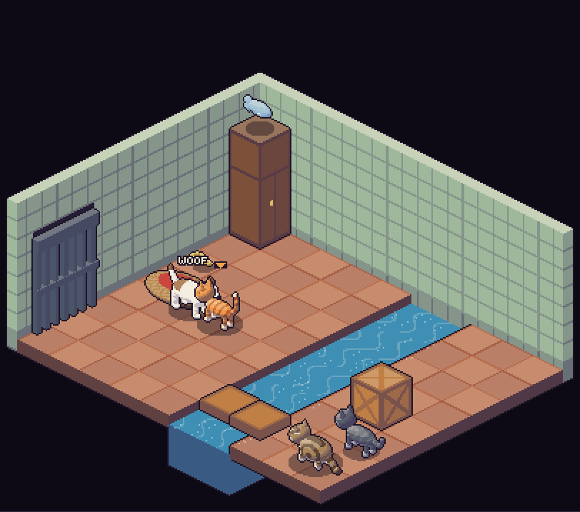
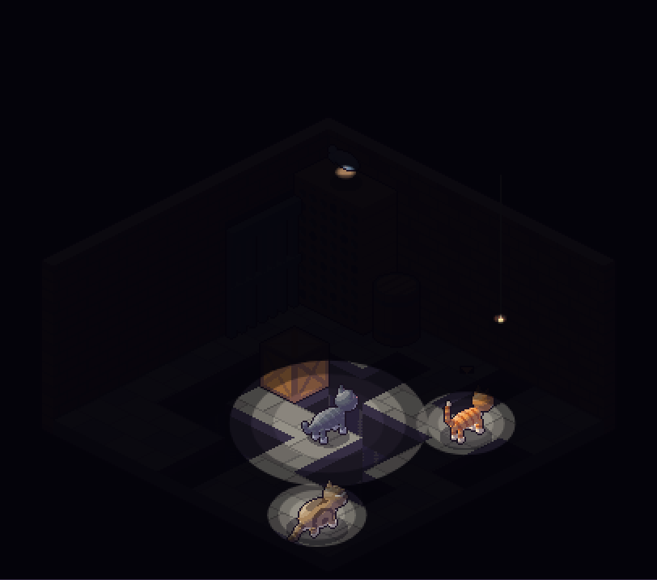
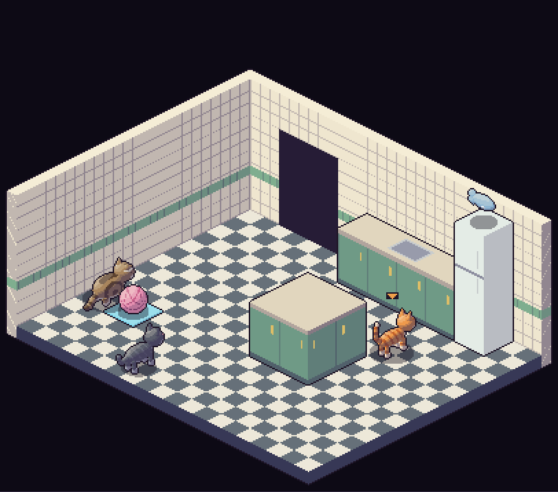
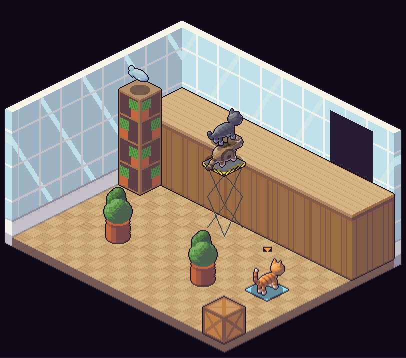

# Moe, Joe & Mr Mews

An isometric puzzle game for three cats, in the spirit of *Head Over Heels* and *Batman* on the ZX Spectrum. Work your way through eight rooms of a house, switching between the cats and using each one's knack to get all three out of every room, fish in mouth.

| | |
|---|---|
|  |  |
|  |  |

## Play

Open `index.html` in a browser. It's a single self-contained page, so no server or install is needed.

To play it online, turn on GitHub Pages for this repository (Settings → Pages → deploy from the `main` branch, root folder). Pages works on public repositories on any plan, or on private ones with GitHub Pro or a paid organisation plan.

Progress is saved in your browser, so the title screen offers **Continue** from the last room you reached. To jump straight to a room, add `#room1` to `#room8` to the address.

## The cats

| Cat | Who | Knack |
|---|---|---|
| **Moe** | Slim ginger with stripes | Jumps highest. |
| **Joe** | Dark grey, faint stripes | Squeezes through narrow gaps, sneaks past a sleeping dog, sees furthest in the dark. |
| **Mr Mews** | Old, round tabby | Pushes and pulls crates and the pouffe, weighs down heavy plates, makes a handy step. |

Cats can stand on each other's backs, which is how you build a cat tower.

## Controls

| Key | Does |
|---|---|
| Arrow keys / WASD | Walk along the floor grid: ↑ heads up-right, → down-right. Press two for a straight line on screen. |
| Space | Jump (hold it on the pouffe to keep bouncing) |
| Shift / X | Hold while walking away from a crate to pull it (Mr Mews only) |
| Tab, 1–3 | Switch cat |
| R | Restart the room |
| M | Sound on or off |

On a phone or tablet, on-screen buttons appear instead.

## The rooms

1. **The Store Room**: a heavy plate, a button behind a fence, and a fish on a high ledge.
2. **The Scullery**: a water channel to bridge with sunken crates, a dog guarding a key, and a fish on a tall cupboard.
3. **The Laundry**: a robot hoover, two pads to press at once, and a cat tower for the fish on the boiler.
4. **The Bedroom**: a springy pouffe, and an exit up on a landing.
5. **The Cellar**: pitch dark, coal holes in the floor, and a light cord to find.
6. **The Kitchen**: a ball of wool that rolls until it hits something.
7. **The Conservatory**: a lift to a high gallery, and a crate wedged in a corner.
8. **The Attic**: everything at once.

## How it's made

The art is built in code. The cats, the dog and every prop are 3D shapes (ellipsoids, cylinders and boxes) that are ray-cast through an isometric camera and lit from the top left. The result is quantised onto hand-tuned colour ramps to give the pixel-art look.

| File | What it is |
|---|---|
| `art/make_iso.py` | The cat models, the isometric camera, lighting and colour ramps |
| `art/assets.py` | Renders every sprite and writes `art/assets.js`. That covers the cats in 8 directions (walking, pulling, carrying the fish or key), the dog, the props and the room backgrounds. |
| `src/game.html` | The game itself: rooms, physics, puzzles, title screen, sound (Web Audio, no sound files) and saving |
| `build.py` | Inlines the sprites into the game and writes `index.html` |

To rebuild after changing anything:

```sh
pip install pillow
cd art && python3 assets.py && cd ..   # only needed if the art changed (about 40 seconds)
python3 build.py                        # writes index.html
```

The rooms are defined in the `ROOMS` list in `src/game.html`. One floor tile is 12 units, `x` runs down-right, `z` runs down-left and `y` is up. The cats jump 28 (Moe), 14 (Joe) and 6 (Mr Mews) units high, plus 16 off the pouffe, so heights in the room definitions decide who can reach what.

## Tests

The play-tests drive the cats with real key presses in a headless browser. They play every room through to the end and check that the intended obstacles really do block, for example that Mr Mews can't jump onto the landing and Joe can't reach the light cord.

```sh
pip install playwright
playwright install chromium
python3 tests/run_all.py
```

Screenshots from the runs land in `tests/shots/`.
